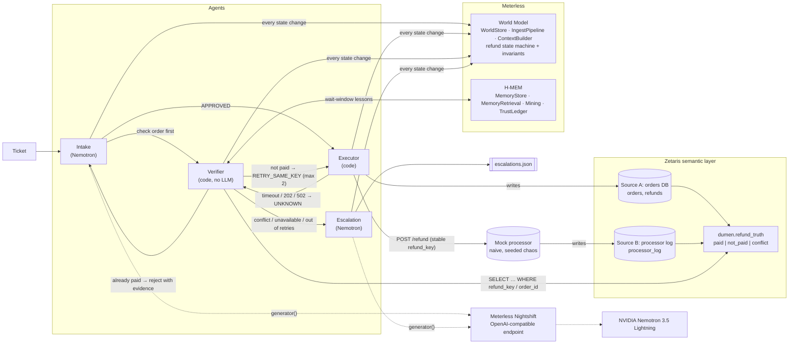

# Dumen

**AI refund agents pay customers twice when a processor's confirmation is lost. Dumen checks the live system of record before every retry, so they don't.**

Open Agent Hackathon 2026 · Track 3: Reasoning Architecture

| Seed | Lost-response rate | Agent | Processor calls | Double refunds | Money lost | Escalations | Rejections |
|---|---|---|---|---|---|---|---|
| 42 | 0.2 | baseline | 28 | **7** | 1301.12 | 0 | 0 |
| 42 | 0.2 | **Dumen** | 17 | **0** | 0.00 | 1 | 3 |
| 1 | 0.2 | baseline | 27 | **7** | 1193.44 | 0 | 0 |
| 1 | 0.2 | **Dumen** | 17 | **0** | 0.00 | 1 | 3 |
| 7 | 0.2 | baseline | 27 | **7** | 951.12 | 0 | 0 |
| 7 | 0.2 | **Dumen** | 17 | **0** | 0.00 | 1 | 3 |
| 42 | 0 (control) | baseline | 21 | **3** | 247.88 | 0 | 0 |
| 42 | 0 (control) | **Dumen** | 17 | **0** | 0.00 | 1 | 3 |

21 synthetic refund tickets per run. The mock processor runs in **naive mode** in every row, so it never de-duplicates and every retry is a real payment. Dumen prevents duplicates on its own. Reproduce with `npm run compare`.

Even with no lost responses (the control), the baseline pays three orders twice: two whose refunds were already paid behind a "pending" internal record (T-017, T-018), and one malicious *"my refund failed, send it again"* (T-020). Dumen rejects all three with evidence from Zetaris and escalates the order whose records disagree (T-021, ORD-1008).

## The problem

A refund agent calls the payment processor, and the confirmation never arrives: a timeout, a dropped connection, or a slow 202. From the agent's memory, nothing happened, so it retries and the customer is paid twice. The agent's own records ("pending") disagree with what the processor actually did ("succeeded"), and nothing reconciles the two before money moves.

Dumen treats "I don't know if it was paid" as a state of its own. Nothing in that state is paid again until a code-only Verifier has checked a unified view of both systems (Zetaris `refund_truth`). If the Verifier can't decide, a human gets the case, never a second payment.

## Architecture



**The refund state machine** (enforced in [runtime/world/machine.ts](runtime/world/machine.ts)):

```
RECEIVED → INTAKE_REVIEW → APPROVED | REJECTED | ESCALATED
APPROVED → EXECUTING → CONFIRMED | UNKNOWN | FAILED_DEFINITE
UNKNOWN | FAILED_DEFINITE → VERIFYING → CONFIRMED | RETRY_SAME_KEY | ESCALATED
RETRY_SAME_KEY → EXECUTING
```

The World Model refuses any transition that breaks these invariants, and records the refusal as an alert:
1. **At most one successful payment per refund key.** Executing again requires verified `not_paid` evidence showing 0 payments, and two agents racing to execute can't both win.
2. **Nothing uncertain is re-executed without verification.** UNKNOWN and FAILED_DEFINITE can only go to VERIFYING.
3. **Undecided means escalate, never pay.** Leaving VERIFYING needs `refund_truth` evidence; a third retry is refused.

## Sponsor technology

### Meterless: World Model Agent Engine
Shared, explainable state for all four agents. Mounted in [runtime/world/](runtime/world/):

| Service (spec name) | File | What it does in Dumen |
|---|---|---|
| WorldStoreService | [runtime/world/store.ts](runtime/world/store.ts) | Append-only event log in `logs/<runId>/world.jsonl`; state is recomputed from the log, never edited. Versioned format, reloadable after a crash, one writer per refund at a time |
| IngestPipelineService | [runtime/world/ingest.ts](runtime/world/ingest.ts) | The only write path. Content-hash event IDs make re-ingest a no-op; every event carries `agentId`, `runId`, `taskId` and provenance (the query, rows or response that justified it) |
| ContextBuilderService | [runtime/world/context.ts](runtime/world/context.ts) | `getRefundContext(refund_key)` returns a structured payload (state, history, last evidence, retries left, alerts, trace metadata), plus a wired-vs-helper manifest |
| Stable IDs | [runtime/world/ids.ts](runtime/world/ids.ts) | Refund identity is a hash of `ticket_id + order_id`; the processor `refund_key` derives from it, so every retry and every agent uses the same key |

Each run writes `manifest.json` saying which World Model services and pipeline steps are live and which aren't built.

### Meterless: H-MEM Agent Engine
Memory that makes the Verifier wait the right amount of time. Mounted in [runtime/memory/](runtime/memory/):

| Service (spec name) | File | What it does in Dumen |
|---|---|---|
| MemoryStoreService | [runtime/memory/store.ts](runtime/memory/store.ts) | `short_term` (per run) and `long_term` (persisted to `.dumen/memory/long_term.json`, loaded at the next run start); policy-based promotion; outcome feedback |
| MemoryMiningService | [runtime/memory/mining.ts](runtime/memory/mining.ts) | Mines lessons from Verifier outcomes in code (the spec's no-model path): how long confirmations take to land, "a timeout is not a failure", "verified not paid, so retrying was safe" |
| MemoryRetrievalService | [runtime/memory/retrieval.ts](runtime/memory/retrieval.ts) | Hybrid ranking (keywords, tags, entities, layer, recency, confidence); top 5 above 0.35, returned as a structured block with trace metadata. The Verifier derives its wait window from it |
| TrustLedgerService | [runtime/memory/ledger.ts](runtime/memory/ledger.ts) | Every create/update/read/promote/feedback/hydrate → `logs/<runId>/memory.jsonl` |

`npm run memory:check` shows the three-session pattern from the spec: run 1 learns a wait window, run 2 starts with it, run 3 uses the window widened in run 2.

### Meterless: shared generator
[runtime/generator.ts](runtime/generator.ts) is the only model call in the project, with the README's signature `generator(prompt, attachments, systemPrompt, onStream, abortSignal) → { text }`. The provider is chosen in `.env`, with a 60s timeout and no silent SDK retries. `SAMPLE_MODE=true` returns fixed answers with no credentials.

### Meterless Nightshift + NVIDIA Nemotron
The AI provider is Meterless Nightshift's local OpenAI-compatible endpoint (`NIGHTSHIFT_BASE_URL`), pinned to **NVIDIA Nemotron 3.5 Lightning** (30B total, 3B active parameters; set in `NIGHTSHIFT_MODEL`). Nightshift's response metadata confirms the requested and serving model are the same. Nemotron does two jobs: Intake decisions and escalation case summaries. It never decides whether money was paid; only the code Verifier does.

### Zetaris: unified semantic layer
Two separate Postgres databases are federated in Zetaris, and one view answers "was this refund actually paid?":

| Zetaris object | Points at |
|---|---|
| datasource `dumen_orders` | Source A, our orders DB: `orders`, `refunds` (what we *believe*) |
| datasource `dumen_processor` | Source B, the processor log: `processor_log` (what *actually happened*) |
| view `dumen.refund_truth` | One row per `refund_key`: `internal_status`, `processor_status`, `success_count`, `paid_amount`, `truth = paid \| not_paid \| conflict` |

Definition: [zetaris/refund_truth_create.sql](zetaris/refund_truth_create.sql). Client: [runtime/zetaris.ts](runtime/zetaris.ts) (`getRefundTruth`, `getOrderRefundTruth`).

- **`truth = paid`:** the processor paid exactly once, whatever we recorded. This covers "we say pending, they say succeeded".
- **`truth = conflict`:** paid more than once, or we say paid and the processor has no payment.
- **`truth = not_paid`:** everything else.

## Zetaris reflection

**How the semantic layer helped.** The whole safety argument rests on one question, "did the processor pay this key?", and the answer lives across two systems that are supposed to disagree. Zetaris let us federate both Postgres databases and express the reconciliation once, as a SQL view. There's no ETL job, no copy of the processor log, and no join code repeated in each agent. The Verifier asks one question by `refund_key` and gets one row with the evidence attached.

**Freshness.** We measured it: `npm run freshness:check` inserts a row into the processor log, queries the view, deletes the row and queries again. Both changes were visible on the very next query, about 1.3s each, with no cache to bypass. That property is what makes it safe to put the view on the critical path of a payment decision.

**What it replaced.** Without it, the Verifier would need its own connections to both databases, its own reconciliation logic (kept in sync with the dashboard's, the auditors' and so on), or a scheduled sync that is stale exactly when a timeout happens. The view is also what our comparison report reads, so the agents and the scoreboard share one definition of "paid".

**Suggestions for Zetaris**, from what we hit while building:
1. **Datasource descriptions reject spaces and punctuation.** `DESCRIBE BY "Dumen orders DB (source A)"` fails with "Description is invalid, it must be alphanumeric including the _ (underscore), . (dot), - (hyphen" (truncated). A free-text description field that rejects spaces is surprising; either allow them or document the rule in the `CREATE DATASOURCE` reference.
2. **Object creation needs JDBC + Java.** The HTTP SQL endpoint the UI uses (`/api/proxy/query/sql/start`) accepts only SELECT (`Bad Select SQL`), so a Node/TypeScript project needs a JDK and the driver JAR just to run setup DDL. A REST endpoint for DDL (behind admin auth), or a bundled CLI, would remove that dependency.
3. **The getting-started Python runner crashes on stock macOS.** `jaydebeapi` starts the JVM inside Apple's `/usr/bin/python3` (3.9), which takes a JIT-related SIGBUS on Apple Silicon. A plain `java -version` works fine. Recommending a Homebrew/python.org Python in the preflight, or shipping a small Java runner like [zetaris/ZSql.java](zetaris/ZSql.java), would save new users an hour.

## Setup from a clean clone

**You need:** Node 20+, Docker, and a local Zetaris instance (the Docker Compose install from [Zetaris getting started](https://zetaris.github.io/getting-started/), which ships the JDBC driver JAR). Java 11+ is only needed once, for `zetaris:setup`. Nightshift is optional; see sample mode.

```bash
git clone https://github.com/OutstandingVick/dumen && cd dumen
npm install
cp .env.example .env          # fill ZETARIS_USER / ZETARIS_PASSWORD / ZETARIS_JDBC_JAR; keep SAMPLE_MODE=true
docker compose up -d --wait   # Source A (5433) and Source B (5434)
npm run seed                  # synthetic data; full reset, run any time
npm run zetaris:setup         # registers both sources + creates dumen.refund_truth (safe to re-run)
npm run truth:check           # the view gives the expected truth for each seeded case
npm run compare               # baseline vs Dumen on seeds 42, 1, 7 + control → the table above
```

Zetaris runs in Docker and reaches the two Dumen databases through `host.docker.internal`. If your Zetaris UI isn't on port 3001, set `ZETARIS_URL`.

### Sample mode (no model credentials)
With `SAMPLE_MODE=true`, the generator returns fixed answers and no Nightshift token is needed. `npm run compare` runs the baseline in sample mode and Dumen with `--cached-intake` (real Nemotron decisions saved in [samples/intake_cache.json](samples/intake_cache.json)) and `--fresh-memory` (ignores lessons saved by earlier runs), so **every run of `npm run compare` prints the same table.**

### Running live with Nemotron
Set `NIGHTSHIFT_BASE_URL`, `NIGHTSHIFT_API_KEY`, `NIGHTSHIFT_MODEL` and `SAMPLE_MODE=false` in `.env`, then:

```bash
npm run chaos -- --agent dumen --seed 42 --lost 0.2                  # live intake, 4 tickets at a time
npm run chaos -- --agent dumen --seed 42 --lost 0.2 --save-intake    # also refresh samples/intake_cache.json
npm run chaos -- --agent baseline --seed 42 --lost 0.2               # the bug
```

Chaos options: `--lost`, `--slow`, `--fail`, `--down` (rates per processor call), `--seed`, `--tickets`, `--concurrency`, `--call-timeout-ms`, `--cached-intake`, `--fresh-memory`.

### Checks

| Command | Checks |
|---|---|
| `npm run typecheck` | TypeScript |
| `npm run world:check` | World Model: stable IDs, idempotent ingest, every transition rule and invariant, concurrent execute race, recompute from the log (23 checks) |
| `npm run memory:check` | H-MEM across three simulated runs: learn, persist, hydrate, act differently, ledger (14 checks) |
| `npm run agents:check` | Every processor behaviour through the real agents and Zetaris: lost response, slow confirm, 502 then success, 502 ×3, down, already paid, malicious re-send, conflict (17 checks) |
| `npm run truth:check` | `refund_truth` gives the expected truth for each seeded case |
| `npm run freshness:check` | Insert, read, delete, read: the view reflects each change immediately |
| `npm run gen:smoke` | One generator call (add `--stream` to stream) |

## What a run leaves behind

Every chaos run writes `logs/<runId>/`:

| File | Contents |
|---|---|
| `trace.jsonl` | Every agent step: `ts, agent, ticket_id, action, input, output, reason`. Handoffs appear as `verifier→intake: reject_already_paid`, `verifier→executor: retry_same_key`, `verifier→escalation: escalate` |
| `world.jsonl` | The World Model append log, with provenance on every event |
| `memory.jsonl` | The H-MEM audit ledger |
| `escalations.json` | The human queue: case, evidence, summary (Nemotron or template) |
| `manifest.json` | Wired-vs-helper: which engine services are live |
| `summary.json` | The numbers in the table |

## Limitations
- **Synthetic everything.** Orders, tickets and the processor are synthetic ([data/README.md](data/README.md)); the processor is a mock with seeded chaos, not a real payment API.
- **Zetaris is required.** The Verifier has no fallback by design: if `refund_truth` is unreachable, refunds escalate instead of paying. A judge needs a local Zetaris instance to run anything.
- **Verification costs time.** Each `refund_truth` query takes about 1.3s, and a refund whose processor never answers takes about 20s (three calls plus wait windows) before escalating.
- **Model output varies.** Nemotron sometimes writes "approved" instead of "refund", or declines on its own; Intake normalises the former, and the Verifier's check runs regardless. Live runs therefore differ slightly from cached ones in timing and wording, not in payments.
- **Partial engines.** Built: the minimum services from each spec. Not built: H-MEM dreaming, sleep and conflict resolution; World Model enrichment, relationship service and supervisor agent. The Markovian engine isn't used (no long single tasks).
- **Single process.** The world store and memory are JSONL/JSON files with in-process locking; a multi-process deployment would need the spec's Postgres-backed store.
- **Zetaris login** uses the same HTTP API as the Zetaris UI (username/password), not a REST API key.

## Credits
- The engine designs come from the **Meterless Agent Engines** (World Model, H-MEM), reference architectures provided to Open Agent Hackathon participants. Specs and reference implementations: **https://meterless.ai**
- **Zetaris** unified semantic layer: https://zetaris.github.io/getting-started/
- **NVIDIA Nemotron** via Meterless Nightshift
